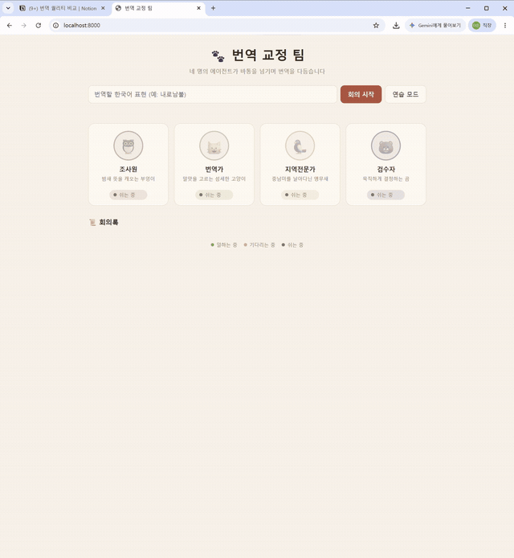

# 🐾 사룟값 버는 동물 번역팀

> 에이전트 **네 마리**가 한 팀으로 일합니다. 누가 지금 무엇을 하고 있는지, 화면에서 보입니다.

```
🦉 조사원  →  🐱 번역가  →  🦜 지역전문가  →  🐻 검수자
```



---

## 왜 만들었나

에이전트가 여럿이면 로그가 쏟아집니다. 글자만 봐서는 **지금 누가 일하고 누가 기다리는지** 알기 어렵습니다.

그래서 **보이게** 만들었습니다.
아이소메트릭 사무실에 네 마리가 앉아 있고, 일하는 중이면 통통 들썩이고,
기다리는 중이면 머리 위에 `···` 가 깜빡이고, 말할 때는 말풍선이 뜹니다.

---

## 팀원

| | 역할 | 하는 일 |
|---|---|---|
| 🦉 | **조사원** | 표현의 뜻과 말맛(격식/농담)을 정리합니다. 번역은 하지 않습니다 |
| 🐱 | **번역가** | 조사원의 메모를 보고 후보 번역 **3개**를 냅니다 |
| 🦜 | **지역전문가** | 후보마다 어느 지역에서 통하는지 판정하고, 지역색이 강하면 경고합니다 |
| 🐻 | **검수자** | 종합해서 **최종 하나**를 고릅니다. 중남미 전체에 통하는 중립 표현을 우선합니다 |

> 🦜 앵무새가 지역전문가인 건 우연이 아닙니다. 중남미에 살고, 말을 따라 하는 새니까요.

---

## 모델은 하나, 명함은 넷

네 개의 AI 를 쓰는 게 아닙니다. **같은 모델에 지시문만 다르게** 줍니다.

```python
{
  "아이디": "region",
  "이름": "지역전문가",
  "지시문": "후보 3개가 각각 어느 지역에서 통하는지 판정해라. "
            "지역색이 강한 표현은 반드시 경고해라."
}
```

앞사람의 결과가 뒷사람의 입력으로 들어가는 **바통 터치** 구조입니다.
한 번 돌리면 AI 를 **4번** 부릅니다.

---

## 상태를 움직임으로

| 상태 | 화면 |
|---|---|
| 🟢 **일하는 중** | 캐릭터가 들썩이고 그림자가 같이 줄었다 커집니다 |
| 🟡 **기다리는 중** | 숨쉬듯 천천히 + 머리 위 `· · ·` 깜빡임 |
| ⚪ **쉬는 중** | 흐릿하게, 흑백으로 |
| 💬 **말할 때** | 머리 위 말풍선 |
| ✨ **바통 받을 때** | 얼굴 둘레가 반짝 |

진행 상황은 서버가 **한 줄씩 실시간으로** 보내줍니다(NDJSON).
다 끝나고 한꺼번에 보여주는 게 아니라, 일하는 중간 과정이 그대로 흘러갑니다.

---

## 🔐 열쇠는 페이지에 넣지 않았습니다

웹페이지에 API 키를 넣으면 **소스 보기로 누구나 볼 수 있습니다.**

```
브라우저  ──부탁──▶  서버 (열쇠는 여기만)  ──▶  Groq / Gemini
```

페이지는 서버에게 "회의 좀 돌려줘"라고 부탁만 하고, 열쇠는 `.env` 안에서 나오지 않습니다.

---

## 🎬 연습 모드 — 0원

**AI 를 부르지 않고** 미리 써둔 대본으로 똑같이 움직이는 모드가 있습니다.

화면을 다듬을 때, 발표를 리허설할 때 **수백 번 돌려도 공짜**입니다.
캐릭터의 움직임과 말풍선을 보여주는 데는 이것만으로 충분합니다.

---

## 두뇌가 지치면 다음 두뇌로

```
Groq (gpt-oss-120b)  →  한도 초과면  →  Gemini (flash-lite)
```

어느 모델이 답했는지는 **회의록 오른쪽에 표시**됩니다.

---

## 돌려보려면

```bash
cp .env.example .env    # Groq 키 · Gemini 키
docker compose up
```

👉 http://localhost:8000

입력창에 번역 어려운 말을 넣어보세요. `내로남불` · `잼민이` · `국뽕` · `답정너`

---

## 파일 구성

| 파일 | 역할 |
|---|---|
| `팀.py` | 팀원 네 명의 명함(지시문)과 바통 터치 순서 |
| `server.py` | 열쇠를 들고 있는 작은 웹서버. 회의를 실시간 중계 |
| `static/index.html` | 아이소메트릭 사무실 (SVG — 책상 · 모니터 · 난로 · 화분) |
| `static/style.css` | 캐릭터 생김새와 움직임 |
| `static/app.js` | 서버가 보내는 소식을 받아 캐릭터를 움직임 |

---

## 함께 보기

→ [미니 Muse](https://github.com/daeunshin123-a11y/mini-muse) — 에이전트 **한 명**이 메신저에서 일하는 버전
→ [번역 용어집](https://github.com/daeunshin123-a11y/vibe-glossary-ko-es) — 이 팀이 다루는 번역 데이터의 출발점
